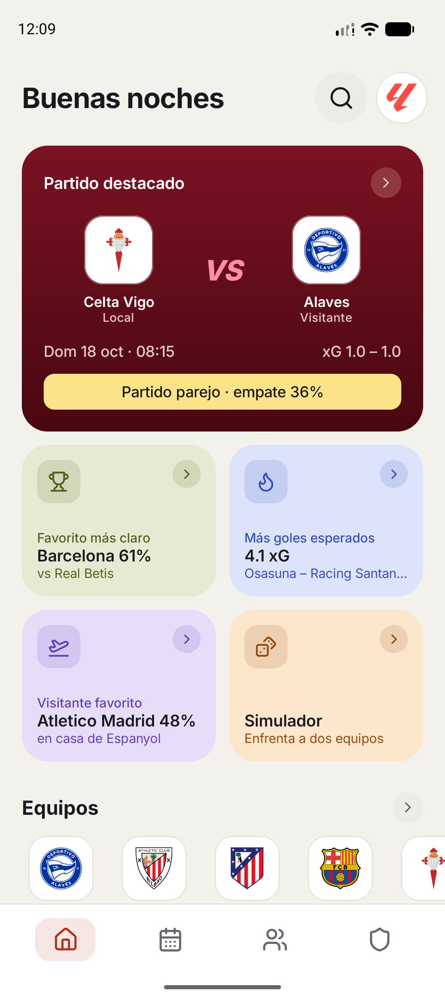
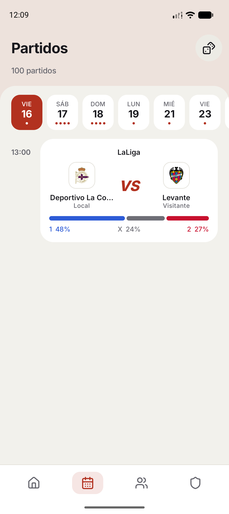
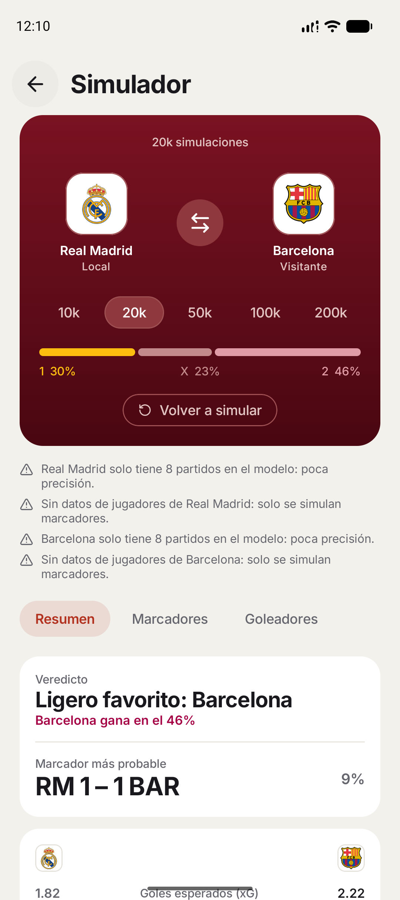
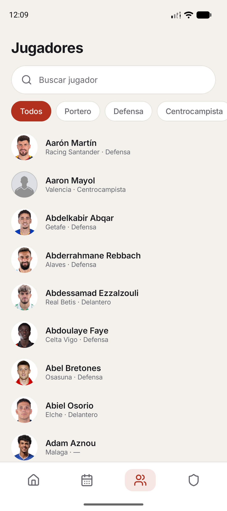
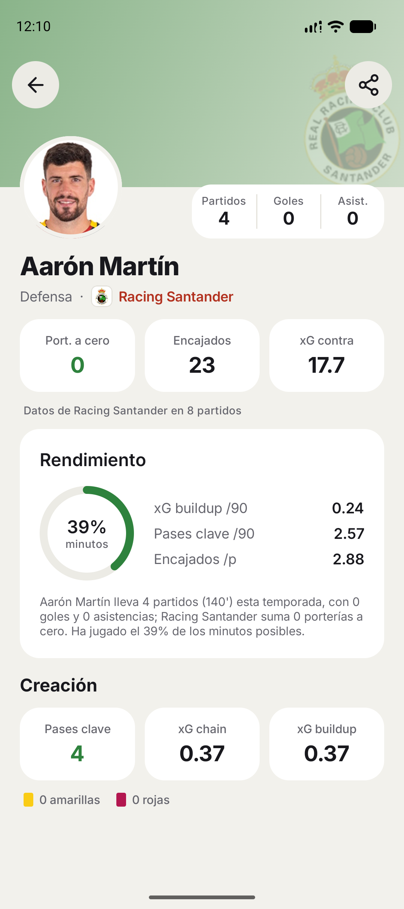
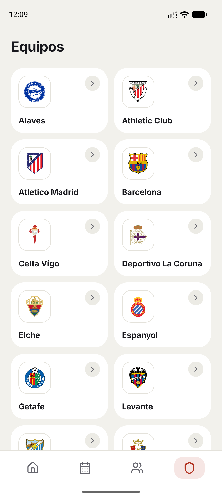

#  FutbolEstadisticas

App Android con estadísticas de jugadores, equipos y calendario de la **Premier League** y **LaLiga**, más simulaciones de partidos para ver qué tan probable es cada resultado.

## Qué hace

- **Jugadores**: goles, asistencias, xG y otras estadísticas, con ficha individual.
- **Equipos**: clasificación y datos de cada club.
- **Partidos**: calendario y resultados.
- **Simulador**: corre miles de simulaciones de un partido y te muestra las probabilidades de victoria, empate o derrota y los marcadores más probables.

## Capturas

<table>
  <tr>
    <td align="center"> <b>Inicio</b> Partido destacado y datos clave</td>
    <td align="center"> <b>Partidos</b> Calendario con probabilidades</td>
    <td align="center"> <b>Simulador</b> Miles de partidos simulados</td>
  </tr>
  <tr>
    <td align="center"> <b>Jugadores</b> Búsqueda y filtro por posición</td>
    <td align="center"> <b>Ficha de jugador</b> Rendimiento y estadísticas</td>
    <td align="center"> <b>Equipos</b> Todos los clubes de la liga</td>
  </tr>
</table>

## Descargar

1. Ve a la sección [**Releases**](../../releases) de este repo.
2. Descarga el archivo `.apk` de la versión más reciente.
3. Ábrelo en tu móvil Android. Si te lo pide, permite instalar apps de orígenes desconocidos.

**Requisitos:** Android 8.0 o superior.

> Como la app no viene de Google Play, el sistema puede mostrar un aviso al instalarla. Es normal.

## Aviso

Es un proyecto de fans, sin relación con la Premier League ni con LaLiga y sin su respaldo. Sus nombres y logos son marcas de sus respectivos dueños y aparecen solo para identificar cada competición. Los datos provienen de fuentes públicas y la app es para uso personal y no comercial.

## Licencia

[MIT](LICENSE)
